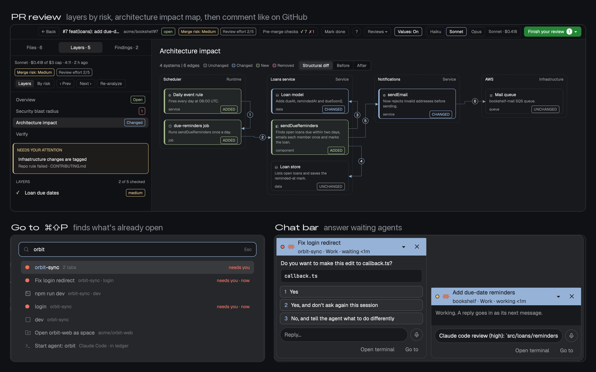
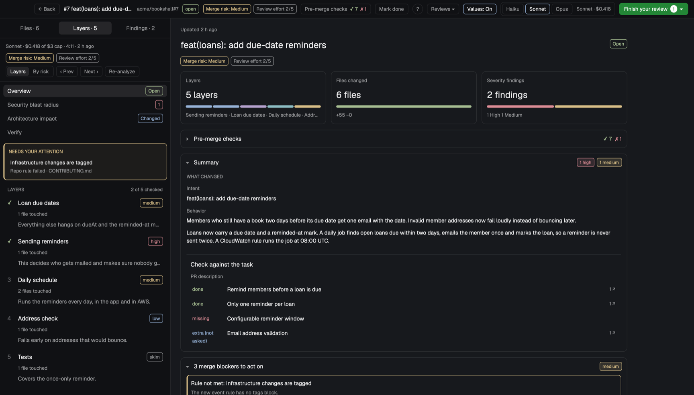
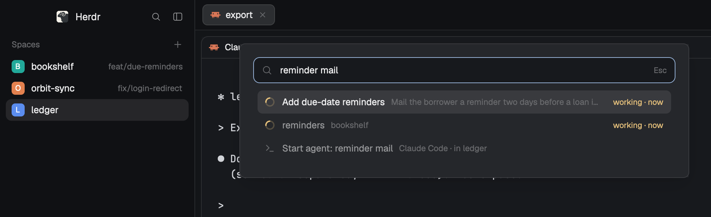
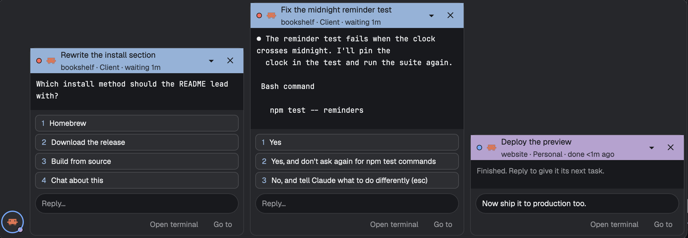
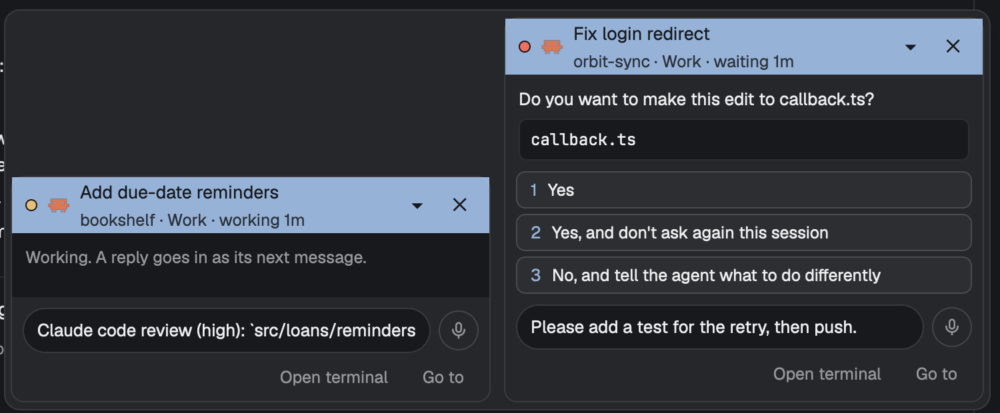
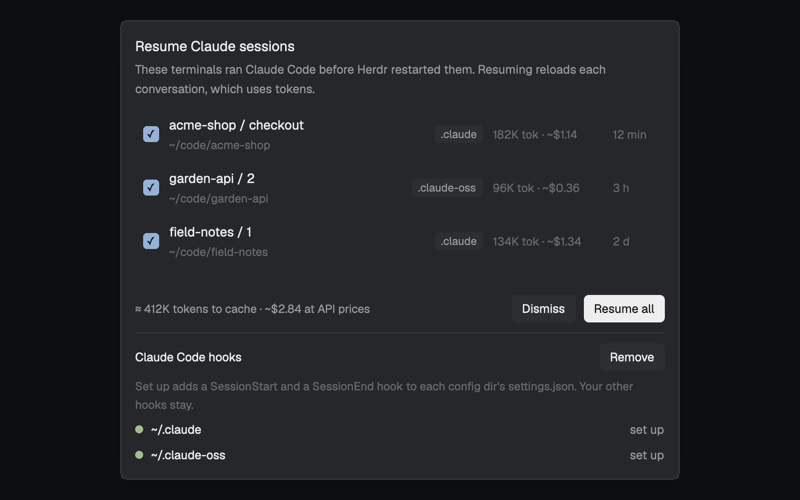
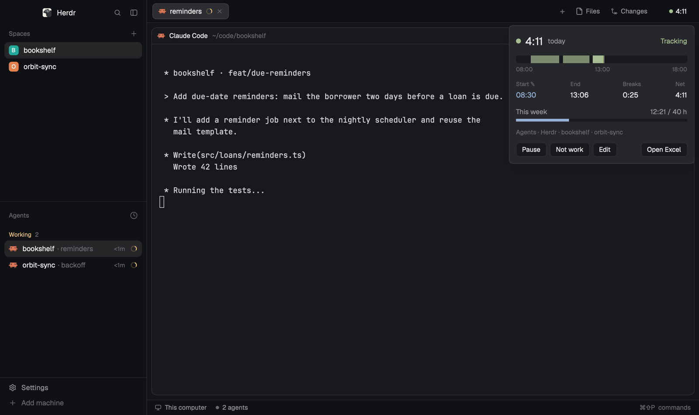

<p align="center"></p>

<h3 align="center">Five Herdr mods that work alone and click together when you install more than one</h3>

<p align="center">One <a href="https://herdr.dev">Herdr</a> window for coding agents, with pull request review the way you'd want it: the change as layers ordered by risk, an architecture map, a security blast radius, state diagrams and sample values in the diff, then GitHub-style comments. Find anything already open with ⌘⇧P, answer waiting agents from a chat bar, dictate, and track your work time. Each part is a mod that works alone; Corgi updates them safely and keeps your edits.</p>

<p align="center"></p>

<p align="center"><sub>✓&nbsp;Free,&nbsp;MIT&nbsp;licensed &nbsp; ✓&nbsp;Runs&nbsp;locally &nbsp; ✓&nbsp;herdr-app&nbsp;0.1.14+</sub></p>

<br />

## Install in three steps

<table>
<tr>
<td align="center" valign="top" width="33%"><h3>1</h3><b>Clone this repo</b><br /><sub><code>git clone https://github.com/saefty/herdr-corgi</code>, then <code>cd herdr-corgi</code>. You need Python 3 and git.</sub></td>
<td align="center" valign="top" width="33%"><h3>2</h3><b>Enable the mods</b><br /><sub><code>./corgi.py enable --all --dry-run</code> shows what it would do. <code>./corgi.py enable --all</code> does it, or name the mods you want: <code>./corgi.py enable goto chatbar</code>.</sub></td>
<td align="center" valign="top" width="33%"><h3>3</h3><b>Restart nothing</b><br /><sub>Herdr reloads mods as soon as their files appear. Some need a key or a block in your layout; each mod's README says which.</sub></td>
</tr>
</table>

`enable` asks before it adds shortcuts to your `keys.json`. With `--all` it never touches `keys.json` unless you add
`--keys=merge`; otherwise it prints the shortcuts for you to add by hand. A key you already use is never rebound.

## What's inside

| | |
|---|---|
|  | **[PR review](https://github.com/saefty/herdr-corgi-pr-review)**: a side panel with the branch's diff and a full-window review: layers by risk, an architecture impact map, a security blast radius, sample values in the diff, reviewer agents whose findings you send back to fix and verify, and comments posted as one GitHub review. |
|  | **[Go to](https://github.com/saefty/herdr-corgi-goto)**: a ⌘⇧P box that finds what is already open before it opens anything new: agents by a few words of their task, spaces, repos, PRs, URLs and Herdr's commands. |
|  | **[Chat bar](https://github.com/saefty/herdr-corgi-chatbar)**: one bubble per agent that waits on you. Read the question, press an option or type a reply, and stay where you are. |
|  | **[Dictate](https://github.com/saefty/herdr-corgi-dictate)**: press a key, speak, press it again; the text is transcribed on your Mac and lands where your cursor is, never sent. macOS on Apple Silicon. |
|  | **[Resume](https://github.com/saefty/herdr-corgi-resume)**: after a reboot, a toast lists the Claude Code sessions that were cut off; tick the ones you want and each resumes in its terminal. Nothing resumes on its own. |
|  | **[Time tracker](https://github.com/saefty/herdr-corgi-timetrack)**: a chip that counts today's work time while you or your agents work, and writes every day to an Excel workbook. |

## Better together

Each mod works on its own. Install more than one and they start helping each other:

- **Go to + PR review:** paste any PR link into Go to and pick "Review PR". Reviews you started show up there too,
  so you can jump back in.
- **Go to + Chat bar:** agents waiting on you show up in Go to. Press Enter to answer in their chat bubble.
- **PR review + Chat bar:** "Discuss in chat" on a finding opens the agent's bubble, so you follow its answer
  without leaving the review.
- **Chat bar + Dictate:** a mic in every bubble. Say your reply and edit it before you send it.
- **Separate setups, like work and personal:** one small mod of your own tells all of them which space belongs
  where. Go to switches before it jumps, the chat bar tags each agent, and the time tracker counts only work.

Remove a mod and the rest keep working. If you write mods yourself, [CONVENTIONS.md](CONVENTIONS.md) shows how to
plug into the same places.

## Let your agent install it

Give it this, in a Herdr terminal:

```text
Read ~/.config/herdr-app/AGENTS.md, clone https://github.com/saefty/herdr-corgi, read its README, run ./corgi.py enable --all --dry-run, show me the result, and run it for real after I say yes.
```

## Install as a layout

Want the whole window at once? The Corgi layout puts Herdr's sidebar and tab bar together with the time chip in the
tab row, the PR panel on the right, and the chat bar and dictation over your terminals.

Give your agent this, in a Herdr terminal:

```text
Read ~/.config/herdr-app/AGENTS.md, then add this layout: https://github.com/saefty/herdr-corgi/tree/main
```

It copies `layouts/corgi.json` and the folders in `mods/`, merges `keys.json` (⌘⇧P Go to, ⌘⇧M dictate, ⌘⇧B the PR
column) and switches to the layout. `ctrl-shift-l` switches back to yours. The mods in `mods/` are copies of each
mod's latest release; to get updates later, clone this repo and run `./corgi.py enable --all`.
[RECIPE.md](RECIPE.md) describes the layout piece by piece.

## Updates

```bash
./corgi.py status            # installed versions, available updates, files you changed
./corgi.py update            # every mod to its latest release, with the changelog
./corgi.py update goto@1.2.0 # one mod to one version
./corgi.py rollback goto     # back to the version before
```

Nothing updates by itself. An update shows what changed, applies it, then runs `herdr-app check` on the mod; if the
check fails, that mod goes back to its previous files.

**New releases wait 3 days.** corgi offers a release only once it is at least 3 days old (the tag's date), so a bad
or compromised release has time to be spotted before it reaches your machine. `status` lists newer releases still
waiting with the day they become available. Change the wait with `./corgi.py config set min-release-age 7`.
`./corgi.py update goto@1.3.0` installs a waiting release after a warning and a yes (or `--yes`).
`./corgi.py config set early-updates on` drops the wait for every mod; it shows a security warning and asks first.
Mods run with your user's permissions, so turn it on only if you trust the authors. Dev checkouts and `sync` ignore
the wait: they install what you or `corgi.lock` name.

Your own edits survive. corgi keeps a clean copy of every version it installed. A file only you changed is kept, a
file only the release changed is replaced, and a file you both changed is merged. If the merge has a conflict, the
whole mod stays on its old version and you choose: `./corgi.py resolve <mod>` opens an agent tab that re-applies your
changes to the new version for you to review, `--keep-mine <file>` keeps yours, or `--take-theirs <file>` takes the
release and saves yours as a patch. `./corgi.py diff <mod>` shows what you changed.

**Update notices inside Herdr.** The `corgi` mod checks once a day and posts one notification when new releases are
out. Click it for the changelog and an Update button that runs `corgi.py update` in a new tab, so you see every step.
The popup also lists releases still in their waiting period ("goto 1.3.0 available on Nov 13"), and has the wait in
days and the early-updates switch (it shows the warning and asks for a second click). Waiting releases never
notify; they do once they become available.
It needs a floating block in each layout you use (`~/.config/herdr-app/layouts/<name>.json`, on the root node); the
block draws nothing:

```json
"floating": [ { "id": "corgi", "content": { "mod": "corgi" }, "edge": "bottom", "align": "end" } ]
```

To open it any time, bind a key to `mod.open {"name": "corgi"}`.

## Develop a mod

The mod's git checkout is the source; you edit the live folder in `~/.config/herdr-app/mods/<mod>`, where Herdr
reloads it on every save.

```bash
./corgi.py dev goto ~/code/herdr-corgi-goto   # link the live folder to your checkout
./corgi.py save goto "fix(goto): rank exact titles first"   # copy live to checkout and commit
./corgi.py release goto minor                 # tests, leak check, herdr-app check, changelog, tag, push
```

`save` refuses when the checkout has other uncommitted changes and never copies the files Herdr generates.
`release` writes the changelog from your Conventional Commits, shows a summary and asks before it pushes.
`./corgi.py sync` installs everything in your `corgi.lock`, which is how you restore a setup on a new machine.
Each repo's CI runs its tests and a leak check on every push; `herdr-app check` needs Herdr's window, so it runs
on your machine before every release.

## License

[MIT](LICENSE)
