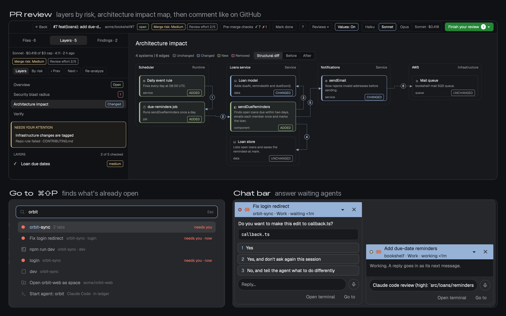

# Corgi

One Herdr window for coding agents, with pull request review the way you'd want it: the change as layers ordered by risk, an architecture map, a security blast radius, state diagrams and sample values in the diff, then GitHub-style comments. Find anything already open with ⌘⇧P, answer waiting agents from a chat bar, dictate, and track your work time. Each part is a mod that works alone; Corgi updates them safely and keeps your edits.



## What you see

Left to right, in the theme's colors (it sets no theme of its own, so the person's light or dark theme applies):

- **Sidebar**, 268 px wide (44 to 480), `chrome` background, no system title bar (the macOS window buttons sit at
  12, 16). Top to bottom: Herdr's brand row (46 px), the spaces list and the agents list (equal halves, at least
  90 px each), and the footer with Settings and Add machine (69 px). These are Herdr's own sidebar mods, unchanged.
- **Tab row**, 42 px high across the rest of the window: Herdr's tab bar (tabs as pills, the + menu) and, at its
  right end, the work time chip, 76 px wide: a green dot while it counts and today's net time (`6:09`). Both drag
  the window.
- **Work area** below it, 8 px padding and 8 px between its two parts:
  - **The tab**: the shown tab's panes as cards, 10 px corners, 8 px apart, `background` fill, a 1 px `border`
    line that turns `accent` on the focused pane, and Herdr's 30 px pane header on top (program, folder, status).
    A lone pane is framed too.
  - **The PR column** on the right, 380 px (280 to 900, drag the edge): the pull request panel for the focused
    space's repo: the PR number and buttons (PRs, Walkthrough, Review, GitHub, `+55 -0`), the changed files, the
    diff with syntax colors, and the pending review with Discard and Send review.
- **Status bar**, 28 px at the bottom of the work column: machine, branch, the agent count and how many need you,
  and the palette key.
- **Floating over the tab**, 12 px from the bottom edge:
  - bottom right, the **chat bar**: one bubble per agent that waits on you and isn't on screen (its question, its
    options as buttons, a reply field with a mic, Open terminal and Go to). Nothing while nobody waits.
  - bottom center, **dictation**: a pill with a pulsing red dot and the time while recording, then
    "Transcribing...". Nothing otherwise.
  - bottom left, the **update notice** block: it draws nothing; it posts a notification when new mod releases are
    out.
- **Go to** is a popup, 620 x 408 px, 60 px below the top, opened with ⌘⇧P.

## How it behaves

- **Agent status** shows where Herdr shows it: the agents list groups agents by status, Needs you (blocked, a red
  `!`), Working (a spinning ring), Idle (an open circle); tabs carry the spinner or a dot for blocked and done; the
  status bar counts "1 needs you" in the `blocked` color. A blocked agent outside the shown tab also gets a chat
  bubble at the bottom right; an option button or a typed reply there goes to that terminal and the bubble goes.
  Working, done and idle agents get no bubble.
- **⌘⇧P** opens Go to: type a few words of an agent's task, a space, a repo, a PR link or a command, Enter goes
  there. Agents waiting on you show as "Reply to ..." and open their bubble. A pasted PR link offers "Review PR",
  which opens the PR in the review layout; "← Back" there returns to Corgi. **⌘⌥⇧P** opens Herdr's palette.
- **⌘⇧M** starts dictation, **⌘⇧M** again stops it: the words are pasted where the cursor is, without Enter. The
  mic in a chat bubble dictates into that bubble.
- **⌘⇧B** (only in this layout) hides or shows the PR column. Its width is dragged at its left edge.
- The **PR panel** follows the focused space: PRs ▾ picks another PR, Walkthrough steps through the AI analysis,
  Review opens the full review layout, hovering a name in the diff shows its definition.
- The **time chip** counts while the person is at the keyboard in Herdr or a work app, or agents run; clicking it
  opens today's timeline, with Edit for start, end and breaks.
- The **update notice** checks once a day after `./corgi.py` has run once, and its notification opens the
  changelog with an Update button.
- ⌘B hides and shows the sidebar, as in Herdr's own layout.

## Built from

`layouts/corgi.json`, root `row` (`titlebar: "none"`, `traffic_lights: [12, 16]`, `background: "canvas"`,
`terminal_padding: [14, 12]`, a 1 px `border` divider, `preview: "layouts/corgi.svg"`):

```
root (row)
├─ sidebar (column, 268 px, chrome)
│  ├─ brand            block  workspace-chrome           46 px, window_drag
│  ├─ sidebar-lists    column: spaces | agents           weight 1 each, min 90
│  └─ sidebar-footer   block  workspace-chrome {footer: true}   69 px
└─ work (column)
   ├─ tabs-row (row, 42 px)
   │  ├─ tabs          block  tabs                       window_drag
   │  └─ timetrack     block  timetrack {part: "bar"}    76 px, window_drag
   ├─ work-body (row, padding 8, gap 8)
   │  ├─ main          block  {tab: "active", pane: {...}}
   │  │                floating: corgi (bottom start), dictate (bottom center), chatbar (bottom end)
   │  └─ review (column, 380 px, 280 to 900)
   │     └─ pr         block  pr-review (no props: the panel)
   └─ status           block  workspace-status           28 px
```

- **Herdr's shipped mods:** `workspace-chrome`, `spaces`, `agents`, `tabs`, `pane` (the pane header),
  `workspace-status`. Not copied; every Herdr has them.
- **Corgi's mods**, each a copy of its release (see `mods/<mod>/BUNDLED.md` and `bundle.json`); each repo's own
  RECIPE.md is the brief for that mod:
  - `goto` ([recipe](https://github.com/saefty/herdr-corgi-goto/blob/main/RECIPE.md)): a popup from its
    `mod.json`, opened by `mod.open:goto`. Searches spaces, tabs, agents, terminals, local clones, layouts and commands;
    runs `git`, `find` and `gh`; keeps a repo cache in the Herdr folder. Other mods add rows through
    `goto.providers` / `goto.items.<mod>`.
  - `pr-review` ([recipe](https://github.com/saefty/herdr-corgi-pr-review/blob/main/RECIPE.md)): the panel with no
    props. Runs `git`, `gh`, `claude`, `python3` and language servers; posts to GitHub only on Submit; reads
    Claude transcripts to find PRs your sessions made; keeps its data in `pr-data/`. The first Review click writes
    `layouts/review.json` from its `review-layout.json` (props `part: "bar"` and `part: "review"`).
  - `chatbar` ([recipe](https://github.com/saefty/herdr-corgi-chatbar/blob/main/RECIPE.md)): the floating
    block. Runs `hc read`, `hc send`, `hc keys` and `python3 progress.py` (reads Claude transcripts); no network.
  - `timetrack` ([recipe](https://github.com/saefty/herdr-corgi-timetrack/blob/main/RECIPE.md)): props
    `part: "bar"` is the chip (`"float"` is the floating variant; no props is the popup). The chip starts
    `python3 track.py`, a small background tracker that samples `ioreg` and `lsappinfo` every 30 s and writes
    `timetrack-data/` and an Excel workbook (default `~/Documents/Timesheets`); no network.
  - `dictate` ([recipe](https://github.com/saefty/herdr-corgi-dictate/blob/main/RECIPE.md)): the floating block,
    which also receives `dictate.toggle`. Runs `python3 voice.py`, `ffmpeg` and parakeet-mlx; reads the clipboard
    and runs `terminal.paste`. The model downloads on first use; nothing else leaves the machine.
  - `corgi`: the floating update notice. Runs `python3 <clone>/corgi.py status --json` once a day and posts a
    `notify()` whose action is `mod.open {"name": "corgi"}`.
- The mods talk only through shared state (`goto.*`, `chatbar.*`, `dictate.*`, `review.*`, `timetrack.*`), as
  CONVENTIONS.md describes. Any one can be removed and the others keep working.
- **Keys** (`keys.json` at the repo root): `global` `cmd-shift-p` `mod.open:goto`, `cmd-alt-shift-p`
  `app.palette`, `cmd-shift-m` `dictate.toggle`; `layout:corgi` `cmd-shift-b` `layout.toggle:review`.
- **Art:** `layouts/corgi.svg`, a 320 x 200 sketch of the regions for Herdr's layout picker.

## Watch out

- **The mods in `mods/` are generated copies** of each mod's release, made by `./corgi.py bundle`. Don't fix bugs
  in them here; each `BUNDLED.md` names the repo to edit. For updates later, clone this repo and run
  `./corgi.py enable --all`: it adopts the copied folders as installed, and `./corgi.py update` then keeps them
  current while keeping the person's own edits. `mods/corgi` is this repo's own updater.
- Copy `layouts/corgi.svg` along with `layouts/corgi.json`; the layout's `preview` points at it.
- Before adding, tell the person: pr-review, goto and the update notice run programs and reach GitHub (pr-review
  also calls Claude when they click Analyze or a reviewer); the chat bar and pr-review read Claude session
  transcripts under `~/.claude`; timetrack runs a background tracker and writes a workbook; dictate records the
  microphone (macOS on Apple Silicon only) and downloads its model once.
- **pr-review's panel is idle in a layout that has a `panel-body` stack** unless it is that stack's shown child
  `pr`. That is why this layout has no Files and Changes panel. Herdr's tab bar still draws its Files and Changes
  buttons, and in this layout they only report that there is no such panel. The person can turn those panels off
  in Herdr's welcome (`app.welcome`, "Choose your panels").
- The keys go in `global`, so ⌘⇧P opens Go to and ⌘⇧M dictates in every layout. Go to and dictation only work
  where their block is shown: Go to everywhere (a popup), dictation only in layouts with its floating block.
- A floating mod whose folder appears while Herdr runs may only load after a restart. If the chat bar or dictation
  doesn't show after switching, restart Herdr once.
- The time chip shows 0:00 until the tracker has seen activity; a window hidden behind others doesn't count as
  Herdr in front.
- The update notice does nothing until `corgi.py` has run once from a clone (it finds the clone through corgi's
  state folder). Without it, no notification and no error.
- pr-review needs `gh` logged in for its PR list; without it the panel's Setup page says what is missing.

## Done when

- `herdr-app check` passes for each of `mods/goto`, `mods/pr-review`, `mods/chatbar`, `mods/timetrack`,
  `mods/dictate` and `mods/corgi`.
- `herdr-app do layout.switch '{"name":"corgi"}'` succeeds and `herdr-app status` shows layout `corgi`, no errors,
  and the floats `corgi`, `dictate` and `chatbar`.
- The tab row shows the time chip at its right end; the PR column shows the focused repo's PR or its Setup page.
- With a blocked agent in another space, its bubble appears at the bottom right and answering it unblocks the
  agent.
- ⌘⇧P opens Go to; ⌘⇧M shows the recording pill at the bottom center and ⌘⇧M again pastes the words.
- ⌘⇧B hides the PR column and shows it again.
- `ctrl-shift-l` cycles back to the person's own layout, which is unchanged.
